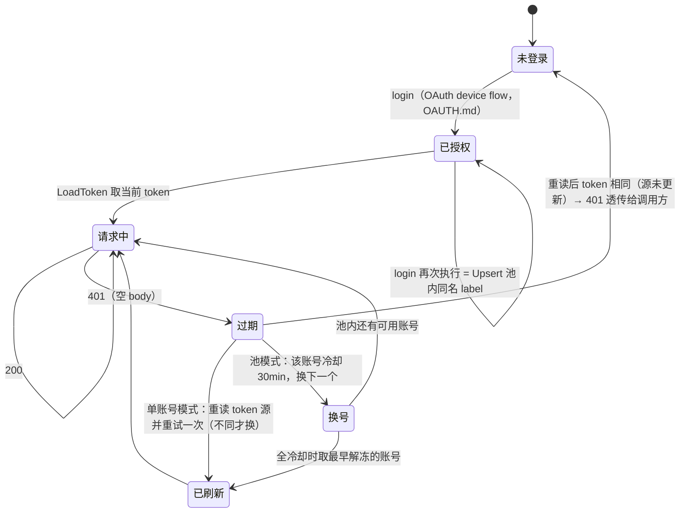

# ZCode token 生命周期（状态机）

> 通道索引：**免费模型请求** → PROTOCOL.md ｜ **OAuth 登录** → OAUTH.md ｜ **付费 V4 签名** → PAID.md ｜ **领取协议** → CLAIM.md ｜ **token 生命周期** → 本文件 ｜ **分析报告** → REPORT.md

zcodejwttoken 短期有效，过期 = 模型请求 **401 空 body**。本文收拢它的来源、存储、
失效处理与刷新路径（此前散在 OAUTH.md 边界与 PROGRESS.md）。

## 状态机

## token 来源链（Go 版，实际代码语义）

**池模式优先**：`token.json` 存在账号（`accounts[]`）时走账号池，此时显式 token 被忽略
（`main.go` serve()：仅池为空才退回单账号）。

单账号链（`internal/zcode/client.go` LoadToken）：

1. `config.json` 的 `token_source`（显式指定，最高优先）
2. 环境变量 `ZCODE_TOKEN`
3. `token.json` 旧格式单对象（`{provider,token,saved_at}`，兼容自动升级为单账号池）
4. `~/.zcode/v2/config.json`：`provider["builtin:zai-start-plan"]` → `builtin:bigmodel-start-plan`
   → 任意 `*-start-plan` 后缀按字典序取第一个（OAuth 登录哪个品牌 token 就在哪个 provider）

运行中自动重读：401 且池为空时，`server.go` upstreamMessages 重跑 LoadToken，取到
**不同的** token 才替换重试一次（CLI/GUI 在别的进程重登后自动生效，网关无需重启）；
重试发生在向下游写出任何字节之前，流式/非流式都安全。

## 存储形态

| 位置 | 形态 | 写入方 |
|---|---|---|
| `<exe>/token.json` | `{"accounts":[{label,provider,token,saved_at}],"active"}`，0600 原子写 | Go 版 login（**不写 ~/.zcode 的 IDE 凭证**） |
| `~/.zcode/v2/credentials.json` | `enc:v1:b64url(iv).b64url(tag).b64url(ct)`，AES-256-GCM，key=SHA256("zcode-credential-fallback:{platform}:{home}:{username}") | ZCode CLI/GUI 登录（网关只读解密，Python 版走这里） |
| `~/.zcode/v2/config.json` | 明文副本（provider[].options.apiKey） | ZCode CLI/GUI 登录 |

Go 版 `DeviceFlow.Login()` 只返回 token，落盘交给调用方——当前实现写 token.json 池。
`auth.go` 里 `WritebackToken`（写回 ~/.zcode 两处）已移除，相关注释残留待清。

## login 细节（device flow）

- init 前 `poll_token` 客户端自造（32B hex）；2026-09 起官方协议要求 poll 改用
  **服务端 init 下发的 poll_token**（空则回落自造值）
- poll 每 2s 一次、上限 150 次（≈5 分钟）；网络抖动 continue 不中断；`failed` 立即终止
- ready 的 `data.token` 即 zcodejwttoken，无二次交换；`data.<provider>.access_token`
  是兑换 project token 的 OAuth 凭证，网关用不到不取
- `login [zai|bigmodel] [label]`：label 默认品牌名，同名 Upsert（重复 login = 刷新该账号）

## 失效与冷却（池模式，client.go cooldownFor）

| 上游错误 | 冷却 | 说明 |
|---|---|---|
| 401 | 30 min | token 失效，长期冷却 |
| 429 | 60 s | 限流/额度 |
| 405 / 3012 | 10 min | 风控（system 前缀失效，见 PROTOCOL.md） |
| 3008 / 3009 / 3010 | 60 s | 并发上限 |
| 其它（400 等） | 不冷却 | 请求本身的问题，换号无意义 |

全冷却时取最早解冻的账号（避免整体不可用）。

## refresh_token

OAuth ready 响应里的 `refresh_token` 已随 poll 数据可见，但**静默续期未实现**——
token 过期唯一出路是重新 login（或 CLI/GUI 重登后 401 自动重读生效）。

## Python 版（legacy）来源链

`Z2API_JWT` 环境变量 > `jwt_override.txt`（明文 token，撤销=删文件）>
`~/.zcode/v2/credentials.json`（tools/zk.py 内存解密，不落盘）。
Python 版已标记 legacy，以 Go 版为准（见该仓库 README）。
